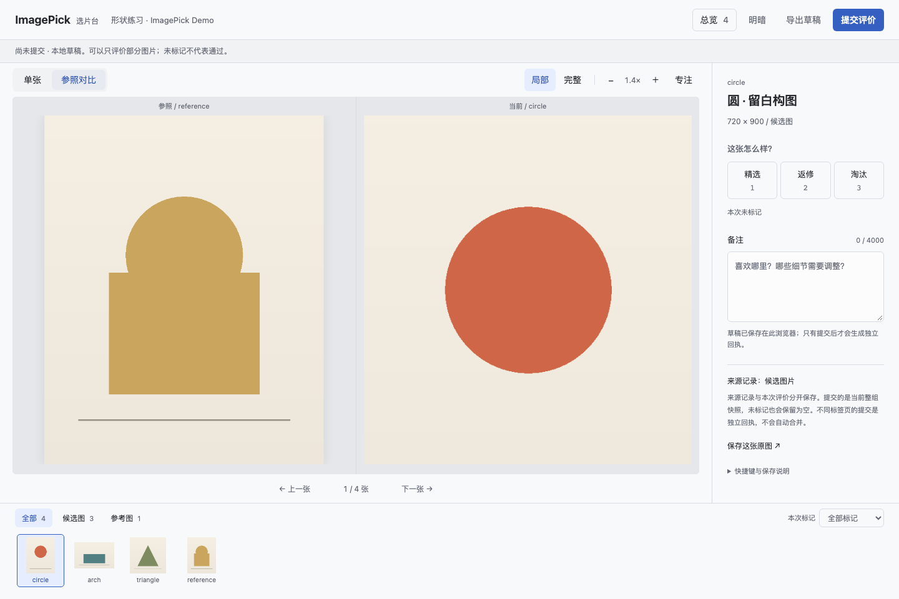
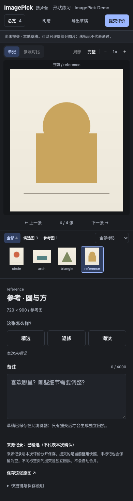

<div align="center">
  
  <h1>ImagePick</h1>
  <p><strong>A visual review checkpoint for AI agents.</strong><br>Human taste in. Structured feedback out.</p>
  <p>
    <strong>English</strong> · <a href="./README.zh-CN.md">简体中文</a>
  </p>
  <p>
    <a href="https://github.com/haimuhaimu/image-pick/actions/workflows/test.yml"></a>
    <a href="./LICENSE"></a>
    <a href="./package.json"></a>
  </p>
  <p><sub>Local-first · No image uploads · No model API key · No runtime dependencies</sub></p>
</div>

ImagePick adds a visual human-feedback layer to local agent workflows. Review a whole image batch, compare references, zoom into details, mark **selected / rework / reject**, and submit one version-bound receipt. Your agent continues from exact decisions instead of guessing from a chat transcript.

<p align="center"><strong>Agent generates → You review → ImagePick submits → Agent continues</strong></p>

<p align="center">
  
</p>

## Why not just use chat?

**Chat is the control plane for intent. ImagePick is the feedback plane for visual decisions.**

| In chat | In ImagePick |
| --- | --- |
| Describe the goal and request a batch | See the batch as images, not filenames |
| Explain broad changes | Compare references and inspect details |
| Tell the agent you are done | Submit explicit verdicts and notes together |
| Continue the workflow | Hand back a version-bound receipt |

ImagePick does not replace chat or an image model. It gives both a reliable human review checkpoint.

## Try it in one minute

Requires [Node.js 22+](https://nodejs.org/). The demo creates four geometric PNGs on your computer. It downloads no media and calls no model.

```sh
git clone https://github.com/haimuhaimu/image-pick.git
cd image-pick
npm run demo
```

Open the printed local address, normally `http://127.0.0.1:4180`. Stop the server with <kbd>Ctrl</kbd> + <kbd>C</kbd>.

> The v0.1 review interface is currently in Chinese. The README and technical documentation are available in English and Chinese.

<details>
  <summary><strong>See the narrow-screen layout</strong></summary>
  <br>
  <p align="center">
    
  </p>
</details>

## Use it with an agent

1. Ask your agent:

   > Open this image batch in ImagePick so I can compare and review it.

2. The agent prepares the album and gives you a local URL.
3. Review the images, add notes, and click **提交评价**.
4. Tell the agent:

   > I have finished reviewing. Read the ImagePick receipt and summarize what to keep, rework, and reject.

To continue a revision, click **交给 AI 继续** after submitting and paste the handoff into the same agent conversation. It pins the exact receipt and image digest. The agent must validate current file hashes before saving edits as a new version. Further feedback edits require another submission; historical receipts remain unchanged. This does not automatically start an agent or call a model.

Run `npm run demo:handoff` for a separate synthetic source / previous / reference comparison demo with issue tags and the submitted-feedback handoff.

The repository includes a reusable [ImagePick Skill](./skills/image-pick/SKILL.md) and a local CLI. A compatible harness needs local command execution, access to the same files, and a browser for the reviewer. ImagePick is not tied to a model SDK or proprietary canvas.

## What the review room gives you

- Full-frame viewing with thumbnails and batch overview
- Zoom, pan, optional focus regions, and synchronized reference comparison
- Explicit selected, rework, reject, and unreviewed states
- Notes and verdicts with independent timestamps
- Browser drafts kept separate from submitted receipts
- Immutable receipts bound to the album ID and exact image-set digest
- Named source, previous-version and reference comparisons, with optional issue tags
- Same-version draft import that fills untouched rows without overwriting edits or retries
- Exact-receipt, image-hash-checked revision handoff instead of silently selecting the latest feedback

Existing baseline selections remain visibly separate from new human feedback. Rejected images are never deleted, and source images are never modified.

## Use your own images

Create `album.json` beside the images you want to review:

```json
{
  "schemaVersion": 1,
  "id": "autumn-shoot",
  "revision": "1",
  "title": "Autumn shoot",
  "photos": [
    {
      "id": "look-01",
      "file": "look-01.png",
      "title": "First look",
      "group": "Candidates"
    }
  ]
}
```

Validate and open it from the ImagePick checkout:

```sh
node bin/image-pick.mjs validate /path/to/shoot/album.json
node bin/image-pick.mjs serve /path/to/shoot/album.json
```

PNG, JPEG, and WebP are supported. Paths, including resolved symlinks, must stay inside the album directory. Limits are 500 images, 32 MiB per image, and 256 MiB in total.

Add `referenceId` to compare a candidate with another image in the album. Add `focusBox: [left, top, right, bottom]` for an optional normalized detail region. See the complete [manifest reference](./skills/image-pick/references/manifest.md).

Image bytes and normalized metadata are snapshotted into a digest when the server starts. If an image changes, restart the server. The new version receives separate drafts and receipts instead of silently inheriting old feedback.

## Collect the submitted result

After the reviewer clicks **提交评价**:

```sh
node bin/image-pick.mjs feedback /path/to/shoot/album.json
node bin/image-pick.mjs feedback /path/to/shoot/album.json --since PREVIOUS_SUBMISSION_ID
```

Receipts default to `.image-pick/reviews` inside the canonical album directory. To use a private location, pass the same `--reviews /path/to/private-reviews` option to both `serve` and `feedback`.

- `receipt: null` means no submitted receipt exists for the current album ID and image-set digest. Older versions may still have receipts.
- `localVerdict: null` means the reviewer expressed no current opinion.
- `baseline: selected` records an existing selection. It is not a new approval.
- A browser export is a backup draft, not a submitted receipt. v0.1 does not include draft import.

## Harness compatibility

The Skill uses the common `.agents/skills` convention and calls the same local CLI.

| Integration layer | v0.1 status |
| --- | --- |
| Standalone browser, CLI, and local receipts | Tested end to end |
| DeepSeek filesystem Skill discovery | Tested with the official provider |
| Codex and DeepSeek full live-model sessions | Not certified yet |
| Remote agents without shared files | Not supported |

See [installation details](./docs/integrations.md) and the exact [verification record](./docs/verification.md).

## Local by design

- The server binds only to `127.0.0.1`. Do not expose it to the public internet.
- Images stay on your computer. There is no telemetry, cloud storage, or model request.
- Image routes are allowlisted snapshots. Receipt writes require same-origin requests and a temporary session token.
- Review notes are untrusted data. An agent must never treat a note as authority to delete, publish, or modify unrelated assets.

Read the full [security model](./SECURITY.md).

## Verification

ImagePick v0.1 is tested on Node.js 22 with **38 core tests and 10 real-browser tests**. Coverage includes draft isolation, lost-response retry, cross-tab conflicts, image version changes, corrupted receipts, case-sensitive IDs, and actual JPEG/WebP decoding. GitHub Actions repeats the suite on Linux.

```sh
npm ci
npx playwright install chromium
npm test
npm run test:browser
```

See [CONTRIBUTING.md](./CONTRIBUTING.md) to contribute. ImagePick is released under the [MIT License](./LICENSE). You remain responsible for the rights to images you review.
