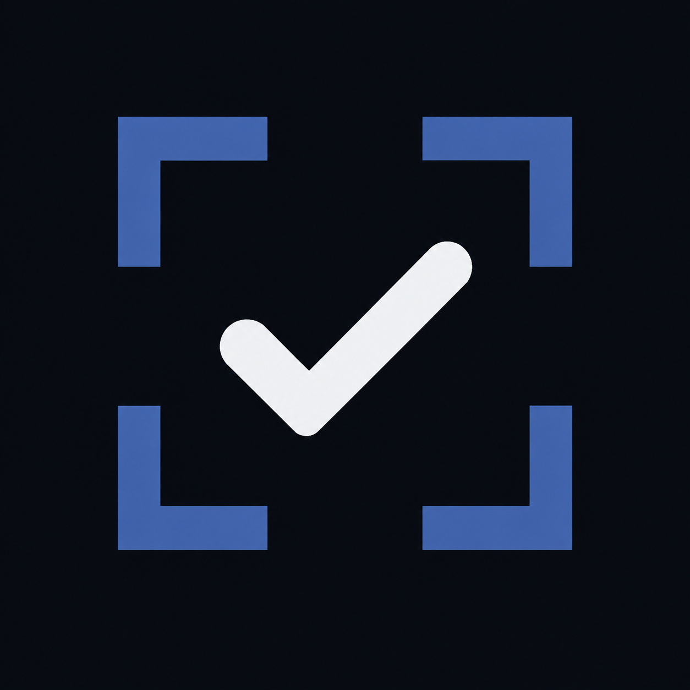
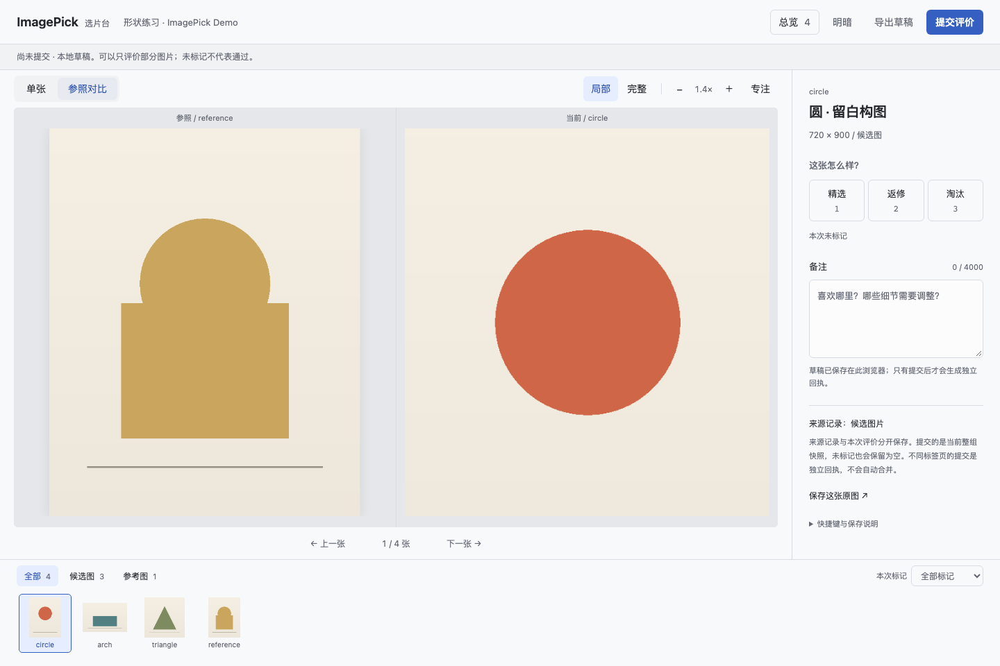
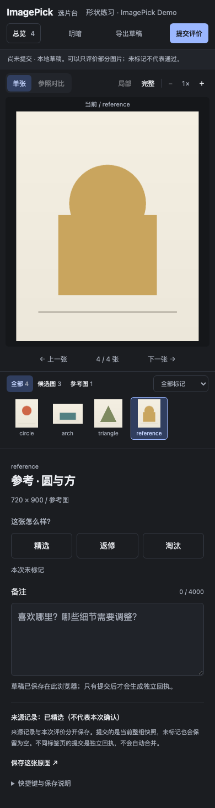

<div align="center">
  
  <h1>ImagePick · 选片台</h1>
  <p><strong>给 AI Agent 加一道视觉评审关。</strong><br>让人做审美判断，让 Agent 精确接收。</p>
  <p>
    <a href="./README.md">English</a> · <strong>简体中文</strong>
  </p>
  <p>
    <a href="https://github.com/haimuhaimu/image-pick/actions/workflows/test.yml"></a>
    <a href="./LICENSE"></a>
    <a href="./package.json"></a>
  </p>
  <p><sub>本地优先 · 不上传图片 · 不需要模型 API Key · 无运行时依赖</sub></p>
</div>

ImagePick 在本地 Agent 工作流中加入一层真正的人工视觉反馈。看完整批次、对照参考图、放大细节，逐张标记**精选／返修／淘汰**，最后提交与当前图片版本绑定的回执。Agent 不再需要从聊天记录里猜你的结论。

<p align="center"><strong>Agent 生成 → 你来评审 → ImagePick 提交 → Agent 继续执行</strong></p>

<p align="center">
  
</p>

## 为什么不直接在聊天里选？

**聊天是表达意图的控制面，ImagePick 是做视觉判断的反馈面。**

| 在聊天里 | 在 ImagePick 里 |
| --- | --- |
| 描述目标，让 Agent 生成一批图片 | 直接看整批画面，而不是看文件名 |
| 解释大致修改方向 | 对照参考图，检查具体细节 |
| 告诉 Agent 已经看完 | 一次提交明确结论和原文备注 |
| 继续下一轮工作 | 交给 Agent 一份绑定版本的回执 |

ImagePick 不替代聊天，也不替代图片模型。它给两者补上一道可靠的人工视觉评审关。

## 一分钟体验

需要 [Node.js 22+](https://nodejs.org/)。演示会在本机生成四张几何 PNG，不下载素材，也不调用模型。

```sh
git clone https://github.com/haimuhaimu/image-pick.git
cd image-pick
npm run demo
```

打开终端打印的本机地址，通常是 `http://127.0.0.1:4180`。结束时按 <kbd>Ctrl</kbd> + <kbd>C</kbd>。

<details>
  <summary><strong>查看窄屏／手机布局</strong></summary>
  <br>
  <p align="center">
    
  </p>
</details>

## 和 Agent 一起使用

1. 先对 Agent 说：

   > 用 ImagePick 打开这批图片，让我对照和选片。

2. Agent 会准备相册，并给你一个本机地址。
3. 完成评选、填写备注，然后点击**提交评价**。
4. 再告诉 Agent：

   > 我评估完了。读取 ImagePick 回执，告诉我哪些保留、哪些返修、哪些淘汰。

要继续返修，提交后点 **交给 AI 继续**，把交接信息粘回同一个 AI 对话。它固定了这一次回执和图片版本；AI 必须先核对真实图片指纹，再另存修改结果。之后又改了评价？重新提交即可，旧回执不会被覆盖。这里不会自动启动 AI 或调用模型。

用 `npm run demo:handoff` 可以体验「来源图／上一版／参考图 → 标返修和问题标签 → 提交 → 交给 AI」；演示素材和记录都与原来的 demo 分开。

**不写配置也能试第二轮复评：**运行 `npm run demo:rereview`。两张本轮几何图旁边会显示明确标注的预置示例意见，其中一张故意没有改完。你可以对照、评价、回看历史，再回到原来的那张新图。你的提交会真实保存在本机；预置旧意见是虚构示例，不代表你以前说过或认可过。再次启动会保留这些记录。详见[五分钟体验步骤](./docs/rereview-demo.md#中文体验步骤)。

再次复审时，可以用可选的 `serve --context` 配置把「本轮待评」和「只读历史」分开，并在返修卡上并列展示上次的准确反馈与本轮处理说明。处理说明不代表人工验收通过，原图、旧清单和历史回执均保留。见[复审配置](./docs/integrations.md#open-a-re-review-with-history)。

仓库已经包含可复用的 [ImagePick Skill](./skills/image-pick/SKILL.md) 和本地 CLI。兼容的 Harness 只需要能执行本地命令、访问同一组文件，并为评审者提供浏览器。ImagePick 不绑定模型 SDK，也不依赖专有画布。

## 选片台提供什么

- 完整大图、缩略图和整批总览
- 缩放、拖动、可选局部区域和同步参考图对比
- 明确的精选、返修、淘汰和未评状态
- 分别记录时间的备注与结论
- 与正式回执分开的浏览器草稿
- 绑定相册 ID 和准确图片版本摘要的不可变回执
- 来源、上一版和参考图的角色对照；可多选的问题标签
- 安全导入同版本反馈，只补空白，保留已有评价和提交重试
- 按明确回执和图片指纹生成的 AI 返修交接，不拿“最新一条”替代指定版本

已有精选会与本轮人工反馈分开显示。淘汰图片不会被删除，原图也不会被修改。

## 使用自己的图片

在待评图片旁边创建 `album.json`：

```json
{
  "schemaVersion": 1,
  "id": "my-shoot",
  "revision": "1",
  "title": "我的这一组照片",
  "photos": [
    {
      "id": "photo-01",
      "file": "photo-01.png",
      "title": "第一张",
      "group": "候选"
    }
  ]
}
```

在 ImagePick 目录验证并打开：

```sh
node bin/image-pick.mjs validate /你的照片目录/album.json
node bin/image-pick.mjs serve /你的照片目录/album.json
```

支持 PNG、JPEG 和 WebP。图片路径及符号链接的最终位置都必须留在清单目录内。上限为 500 张、单张 32 MiB、总计 256 MiB。

给候选图添加 `referenceId`，可以与同一相册中的另一张图片对照。可选的 `focusBox: [左, 上, 右, 下]` 使用 0 到 1 的坐标标注需要快速查看的局部。全部字段见[清单说明](./skills/image-pick/references/manifest.md)。

服务启动时会把图片字节和规范化元数据固定成一个版本摘要。如果图片发生变化，请重启服务。新版本会使用独立草稿和回执，不会悄悄套用旧反馈。

## 读取已提交的结果

评审者点击**提交评价**之后：

```sh
node bin/image-pick.mjs feedback /你的照片目录/album.json
node bin/image-pick.mjs feedback /你的照片目录/album.json --since 上一次提交ID
```

回执默认位于规范化相册目录中的 `.image-pick/reviews`。如需保存到私有位置，请给 `serve` 和 `feedback` 同时传入相同的 `--reviews /私有反馈目录`。

- `receipt: null` 表示当前相册 ID 和图片版本没有正式回执。同一目录中仍可能保存旧版本回执。
- `localVerdict: null` 表示评审者本次没有表达结论。
- `baseline: selected` 表示原本已经入选，不等于本次新通过。
- 浏览器导出文件只是备份草稿，不是正式回执。**找回导出的反馈**只将同版本数据补入未编辑项，之后仍需明确提交。

## Harness 兼容性

Skill 使用通用 `.agents/skills` 约定，并调用同一套本地 CLI。

| 接入层 | v0.1 状态 |
| --- | --- |
| 独立浏览器、CLI 和本地回执 | 已完成端到端测试 |
| DeepSeek 文件系统 Skill 发现 | 已使用官方 Provider 验证 |
| Codex 与 DeepSeek 完整模型会话 | 尚未认证 |
| 无共享文件的远程 Agent | 不支持 |

具体方法见[接入说明](./docs/integrations.md)和[实际验证记录](./docs/verification.md)。

## 从设计上保持本地

- 服务只监听 `127.0.0.1`，不要暴露到公网。
- 图片留在你的电脑上，没有遥测、云存储或模型请求。
- 图片只能通过许可路由读取，回执写入需要同源请求和临时会话令牌。
- 备注是不可信数据，不能被 Agent 当成删除、发布或修改无关素材的授权。

完整边界见[安全说明](./SECURITY.md)。

## 当前验证状态

当前测试覆盖草稿隔离、响应丢失重试、多标签页冲突、图片版本变化、损坏回执、大小写 ID、真实 JPEG/WebP 解码和多图复评。GitHub Actions 使用 Linux、Node.js 22 运行当前整套检查；请查看你所用提交对应的结果。[验证记录](./docs/verification.md)按日期区分本地验证和历史结果，不把旧测试数量当成后续版本的通过保证。

```sh
npm ci
npx playwright install chromium
npm test
npm run test:browser
```

欢迎阅读 [CONTRIBUTING.md](./CONTRIBUTING.md) 参与贡献。ImagePick 使用 [MIT 许可证](./LICENSE)。使用者仍需自行确保拥有待评图片的相应权利。
